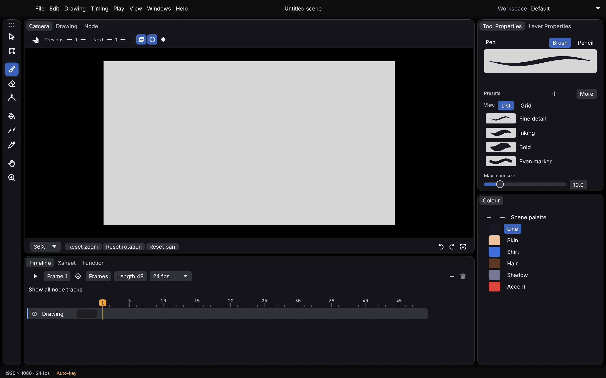

# Symphony

Symphony is a free, open-source 2D animation app for drawing, timing, and
node-based compositing.

[Presentation page](https://tdemers218.github.io/symphony/) ·
[Preview builds](https://github.com/tdemers218/symphony/releases)



## Key features

- **Make room for in-betweens.** Insert frames after the playhead. Current exposures hold through the gap, and later exposures and peg keys shift together.
- **Turn a drawing into an editable matte.** Switch a drawing to a mask and back while keeping its artwork, exposures, and node connections.
- **Bring your brush packs.** Use sampled Photoshop tips in vector strokes and import packs from Krita, Procreate, and MyPaint.
- **Find actions with Search.** Press Tab and type what you want to do. Results prioritize the panel you’re working in.

Not affiliated with Toon Boom. Built clean-room from public documentation
(see [docs/CLEAN-ROOM.md](docs/CLEAN-ROOM.md)).

- **[Plan: status, what's left, full feature list](docs/PLAN.md)**
- **[Design rules](docs/DESIGN.md)** and **[engineering rules](docs/ENGINEERING.md)**: every change follows these.
- [Research](docs/RESEARCH.md) · [Language choice](docs/LANGUAGE.md) · [Roadmap](docs/ROADMAP.md) · [Tablets](docs/TABLETS.md)
- [AI in Symphony](docs/AI-POLICY.md): no generative AI, ever.
- [Codecs](docs/CODECS.md): movie export uses Cisco's OpenH264, downloaded only when you ask.
- [Testing Symphony](docs/TESTERS.md): install the launcher.
- [Contributing](CONTRIBUTING.md): please read the clean-room rules first.

Licensed under GPL-3.0-or-later.

## Build
```sh
cargo test
cargo run --release -p symphony-pentest   # pen test window
```

## Layout
- `crates/symphony-core`: scene model (xsheet, node graph, pegs, evaluation).
  No UI.
- `crates/symphony-pen`: our own pen/tablet input layer (pressure, tilt,
  rotation, eraser), one backend per OS. macOS done; Windows and Linux next.
- `crates/symphony-pentest`: test window that draws with pressure and logs
  every sample to `target/pen-log.csv`.
